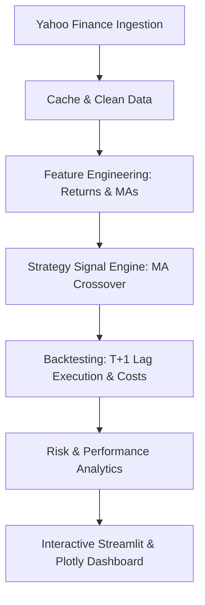

# Quant Trading Research System

An institutional-grade Quantitative Trading Research and Backtesting System engineered for the Indian equity markets (NSE / NIFTY 50). This system automates daily historical data ingestion via Yahoo Finance, calculates core statistical and technical indicators, executes vectorized backtests with zero look-ahead bias and realistic Indian market friction (brokerage, slippage, STT), computes institutional risk metrics, and presents interactive analytics through a Streamlit dashboard.

---

## 📑 Table of Contents
1. [Project Overview](#project-overview)
2. [Folder Structure](#folder-structure)
3. [How It Works](#how-it-works)
4. [Installation & Requirements](#installation--requirements)
5. [Running the Application](#running-the-application)
6. [Backtest & Risk Methodology](#backtest--risk-methodology)
7. [Testing](#testing)
8. [Limitations & Risk Disclaimers](#limitations--risk-disclaimers)

---

## 🔎 Project Overview

The **Quant Trading Research System** enables quantitative analysts and retail traders to rigorously research systematic trading rules before putting real capital at risk:
- **Indian Market Focus**: Native presets for Nifty 50 (`^NSEI`), TCS (`TCS.NS`), Reliance (`RELIANCE.NS`), Infosys (`INFY.NS`), and HDFC Bank (`HDFCBANK.NS`), with support for any custom NSE ticker.
- **Strict Realism**: Complete avoidance of look-ahead bias through lagged signal execution ($t+1$).
- **Realistic Transaction Costs**: Deducts brokerage fees, slippage, and Securities Transaction Tax (STT) only on active turnover days.
- **Institutional Risk Suite**: Calculates Sharpe, Sortino, Calmar, Maximum Drawdown, CAGR, Win Rate, and 95% Historical Value-at-Risk (VaR).
- **Interactive Dashboard**: Streamlit interface with Plotly crossover charts, equity curves, underwater drawdown profiles, and downloadable trade logs.

---

## 📁 Folder Structure

```text
quant_project/
├── data/                       # Local CSV cache for historical price data
│   └── .gitkeep
├── src/                        # Core algorithmic and quantitative library
│   ├── __init__.py
│   ├── config.py               # Centralized parameters, rates, and costs
│   ├── data_loader.py          # Data ingestion, caching, and cleaning engine
│   ├── processing.py           # Returns, moving averages, and volatility
│   ├── strategies.py           # Signal generation (BaseStrategy & MA Crossover)
│   ├── backtester.py           # Vectorized backtest engine & trade log generator
│   └── risk.py                 # Risk analytics (Sharpe, Sortino, VaR, Drawdown)
├── dashboard/
│   └── app.py                  # Interactive Streamlit & Plotly analytics dashboard
├── tests/                      # Automated pytest unit test suite (24 tests)
│   ├── __init__.py
│   ├── test_data_loader.py
│   ├── test_processing.py
│   ├── test_strategies.py
│   ├── test_backtester.py
│   └── test_risk.py
├── requirements.txt            # Dependency specifications
└── README.md                   # System documentation and user manual
```

---

## ⚙️ How It Works

The platform operates across a modular pipeline:



1. **Phase 1: Data Collection (`src/data_loader.py`)**
   - Ingests split- and dividend-adjusted closing prices over a configurable default 10-year period.
   - Intelligent local file caching in `data/` prevents repetitive network requests.
   - Forwards-fills short gaps (up to 5 trading days) and drops leftover NaNs.

2. **Phase 2: Data Processing (`src/processing.py`)**
   - Vectorized simple and logarithmic daily returns.
   - Configurable fast (20-day) and slow (50-day) rolling moving averages.
   - 20-day annualized rolling volatility scaled by $\sqrt{252}$.
   - Pairwise Pearson correlation matrices across stocks.

3. **Phase 3: Strategy Engine (`src/strategies.py`)**
   - **Golden Cross**: Fast MA crosses above Slow MA $\to$ Buy ($+1$).
   - **Death Cross**: Fast MA crosses below Slow MA $\to$ Sell ($0$ in long-only mode, or $-1$ in long-short mode).
   - **Hold**: Retains active position between crossovers.

4. **Phase 4: Backtesting Engine (`src/backtester.py`)**
   - **Zero Look-Ahead Bias**: Signals generated at close of day $t$ can only be traded on day $t+1$. Position is lagged: $\text{position}_t = \text{signal}_{t-1}$.
   - **Transaction Friction**: Brokerage ($0.03\%$), slippage ($0.05\%$), and STT ($0.10\%$) applied strictly on position adjustments.
   - **Portfolio Support**: Equal-weighted capital allocation across multi-stock portfolios.

5. **Phase 5: Risk & Performance (`src/risk.py`)**
   - Compares Strategy performance against Buy-and-Hold of the Nifty 50 benchmark:
     - **Sharpe Ratio** with Indian Risk-Free Rate ($6.5\%$).
     - **Sortino Ratio** measuring excess return per unit of downside deviation.
     - **Underwater Drawdown Analysis** & Calmar Ratio ($\text{CAGR} / |\text{Max DD}|$).
     - **Historical VaR (95%)** representing worst-case single-day loss at 95% confidence.

6. **Phase 6: Interactive Dashboard (`dashboard/app.py`)**
   - Fast-loading `@st.cache_data` caching.
   - Prominent current signal badge (`BUY`, `SELL`, `HOLD`) for live market decisions.
   - Six interactive tabs: Price & Signals, Equity Growth, Drawdown, Metrics Table, Trade Log, and Correlation Heatmap.

---

## 🛠️ Installation & Requirements

Ensure **Python 3.10+** is installed on your system.

```bash
# 1. Clone repository
git clone https://github.com/shivbhardwaj009/quant-trading-research-system.git
cd "python trading platform"

# 2. Install dependencies
pip install -r requirements.txt
```

---

## 🚀 Running the Application

Launch the Streamlit web dashboard locally:

```bash
streamlit run dashboard/app.py
```

Open `http://localhost:8501` in your browser. From the sidebar you can:
- Select individual stocks or multi-stock portfolios.
- Adjust Fast MA (5–100) and Slow MA (20–250) windows.
- Configure starting capital and realistic brokerage / slippage percentages.
- Toggle between Long-Only and Long-Short modes.
- Export executed trade logs directly as CSV files.

---

## 🧪 Testing

The repository includes a comprehensive automated test suite covering all modules:

```bash
python -m pytest tests/ -v
```

### Test Coverage Highlights:
- **`test_data_loader.py`**: Cache freshness, filename sanitization on Windows, gap filling, and offline error handling.
- **`test_processing.py`**: Simple vs log returns, specification check (prices 100, 105, 110 give 5% and 4.76%), and rolling volatility.
- **`test_strategies.py`**: Golden/Death cross detection, warmup handling, and position preservation.
- **`test_backtester.py`**: Mathematical proof of zero look-ahead bias (signals shifted by 1 day) and cost deduction only on turnover.
- **`test_risk.py`**: Small hand-made test cases for CAGR, Max Drawdown, Calmar Ratio, Sharpe, and VaR.

---

## ⚠️ Limitations & Risk Disclaimers

1. **Past Performance**: Historical performance and backtest results are hypothetical and do not guarantee future returns.
2. **Survivorship Bias**: The default stock universe represents prominent, currently surviving companies. Delisted or bankrupt equities are not reflected.
3. **Transaction Costs are Estimates**: Real-world execution involves dynamic bid-ask spreads, order queueing, and market impact, which can exceed static slippage estimates.
4. **No Intraday Execution**: Daily price bars assume trades occur at the closing price of day $t+1$.
